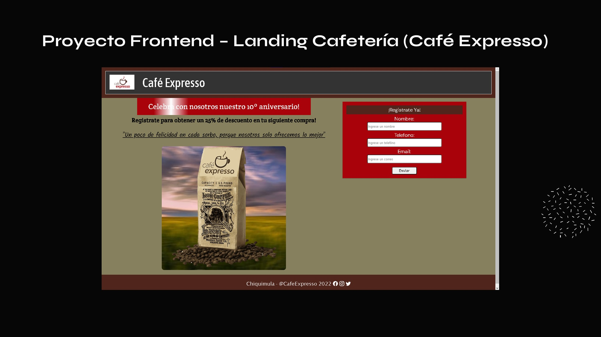

# Café Expresso — Landing Page

Página promocional (*landing page*) para la marca ficticia **Café Expresso**, enfocada en la presentación de una campaña de aniversario y un formulario de registro con validación en el cliente.

## Vista previa

## Características principales

- Encabezado con logotipo e identidad visual de la marca.
- Sección promocional con texto animado, mensaje de aniversario y producto con efecto visual al pasar el cursor.
- Formulario de registro (*Nombre*, *Teléfono* y *Email*) con validación mediante expresiones regulares y despliegue dinámico de errores en pantalla.
- Diseño adaptable (*responsive*) para dispositivos móviles, tabletas y escritorio.
- Pie de página con íconos de redes sociales.

## Tecnologías utilizadas

- **HTML5**
- **SCSS / CSS3** (media queries y animaciones)
- **TypeScript** (compilado a **JavaScript**)
- **Bootstrap Icons** y **Google Fonts** (vía CDN)

## Contexto y estado del proyecto

- **Contexto:** Desarrollado en octubre de 2022 como actividad académica.
- **Estado:** Proyecto estático finalizado (archivado para portafolio).

## Autor

**Daniel Alejandro Arita Leiva**
